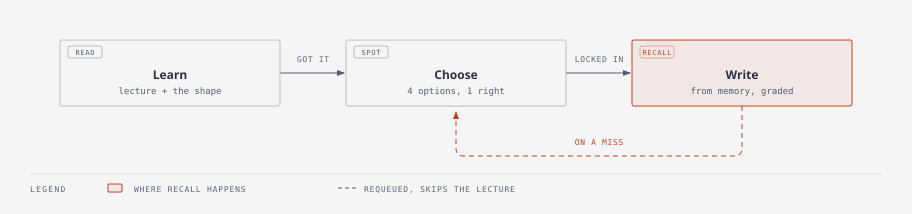
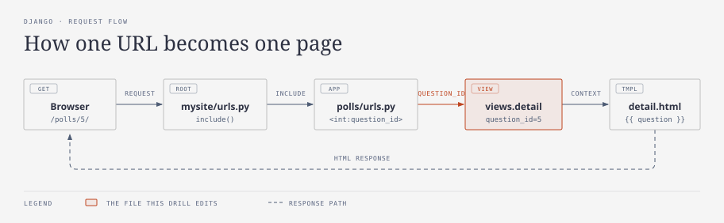

# Syntax Gym

**An AI agent writes your code. It ships. You can't read it.**

You approved a diff you didn't understand. You can't review a teammate's PR in that
stack, and you can't debug it at 2am when the agent stops being useful. That isn't an
argument against agents — it's an argument for being able to verify what they produce.

Syntax Gym drills the syntax your agent is already writing, so you can review a diff
instead of approving it. It skips "what is a variable" entirely and drills only the
moments that go wrong quietly.

81 drills · Django 31 · Python 25 · JavaScript 25 · one HTML file · no signup · MIT

---

## Three screens per drill



**1 · Learn** — the thing itself, plus the one detail that actually bites. There's an
*"I know this, let me write it"* button, because you will already know a third of them.

**2 · Choose** — four options, one right, and a rationale for **every** option including
the ones you didn't pick. This is where the real traps live: `migrate` vs
`makemigrations`, `votes += 1` vs `F("votes") + 1`, `<int:pk>` vs `<int:question_id>`.
Distractors are mistakes you would actually make, not filler.

**3 · Write** — type it cold. On a miss you get a checklist of what's missing but
**not the answer**. You can **Try again** with your text preserved, or reveal it if you'd
rather read it. Your streak counts only first-attempt passes with no hint.

Anything you miss is requeued and served again after the main run.

---

## The tracks

| Track | Drills | Framing |
|---|---|---|
| **Django** | 31 | The 20% of Django you actually have to type, parts 1–4 |
| **Python** | 25 | The Java→Python delta, not "learn Python" |
| **JavaScript** | 25 | The name is the only thing it shares with Java |

Python is written for someone who already knows what a class is: `if __name__ == "__main__"`
as the `main` analogue, `@dataclass` as `record`, `__str__`/`__eq__` as `toString`/`equals`,
`@property` as *why you don't write getters*, context managers as try-with-resources, and the
mutable-default-argument bug — which gets its own drill because no Java habit prepares you for it.

Django Part 1 opens with the one thing prose genuinely cannot convey:



---

## Run it

No build, no install, no server.

```bash
git clone https://github.com/jaysingh10406/syntax-gym.git
open syntax-gym/index.html        # macOS   (xdg-open on Linux, start on Windows)
```

Or download `index.html` on its own and double-click it. Everything — all 81 drills,
the grading engine, both diagrams — is in that one file.

Progress saves to `localStorage`, per track, in that browser only. Nothing is sent anywhere.

### What needs a network, and what happens without one

| Feature | Source | Offline |
|---|---|---|
| Drills, grading, progress | in the file | works |
| Syntax highlighting | highlight.js via cdnjs | degrades to plain monospace |
| Fonts | Google Fonts | falls back to system serif / sans / mono |
| **AI review** of free-form code | the Claude artifact runtime | falls back to the local checklist |

**On AI review:** code answers can be graded by an LLM that reads your answer against the
reference and tells you *why* something is off. That requires the host runtime
(`window.claude`) and therefore only works when the page is served as a Claude Artifact.
Opened from disk or from static hosting, `claude.use()` resolves to `null`, the toggle turns
itself off, and grading falls back to the deterministic required-token checklist — which still
shows you exactly which pieces you missed. Nothing breaks; you just lose the prose feedback.

---

## Grading

Two mechanisms, chosen per drill type:

- **Commands** are checked locally and instantly. Input is normalised first, so `python3`,
  `py` and `./manage.py` all count. A wrong subcommand on the right entry point reads as
  **Close**, not **Miss** — that distinction is the useful signal.
- **Code** is matched against required-token patterns, and additionally sent for LLM review
  where available. The checklist always renders, so you see which specific pieces are missing
  even when the reviewer is unavailable or declined.

Every reference answer in the repo is verified to pass its own grader, so no drill is
unpassable. Every multiple-choice question is verified to have exactly four options, exactly
one correct, and a rationale on all four.

---

## Attribution

Drill content is derived from each language's **official** documentation, not from blog posts
or scraped repositories — because a stale reference answer is worse than no drill. Reading the
current docs is what caught that Django now uses the two-argument
`django-admin startproject mysite djangotutorial` and the `F("votes") + 1` expression, which
most Django tutorials in circulation still get wrong.

| Source | Used for | License |
|---|---|---|
| [docs.djangoproject.com](https://docs.djangoproject.com/en/stable/intro/tutorial01/) | Django track reference answers | BSD 3-Clause |
| [docs.python.org](https://docs.python.org/3/tutorial/) | Python track reference answers | PSF License |
| [MDN Web Docs](https://developer.mozilla.org/en-US/docs/Web/JavaScript) | JavaScript track reference answers | CC-BY-SA 2.5 |

Reference snippets are short, near-verbatim excerpts from those tutorials and remain under
their respective licenses. The explanatory text, the multiple-choice questions and their
rationales, the grading engine, the diagrams and the design are original work under the MIT
licence in [LICENSE](LICENSE). Every drill links back to the exact docs page it came from.

The editorial design system — palette, typography, the no-shadow rule — and the diagram
grammar come from [diagram-design](https://github.com/cathrynlavery/diagram-design) (MIT).
Both diagrams pass that project's own `verify-geometry.py` with zero findings.

Syntax highlighting by [highlight.js](https://github.com/highlightjs/highlight.js) (BSD-3-Clause).

---

## Contributing

The highest-value contribution is **a better distractor**. A multiple-choice option that
encodes a mistake people genuinely make is worth more than another drill. Second-best is a
reference answer that has drifted out of date — those are bugs, and they are the one kind of
bug this project cannot tolerate.

Drill data lives in the `window.TRACKS` objects inside `index.html`. Each drill carries a
`teach` panel, an `mc` block, a `goal`, a `hint`, the reference `answer`, and either `accept`
patterns (commands) or `must` patterns (code).
